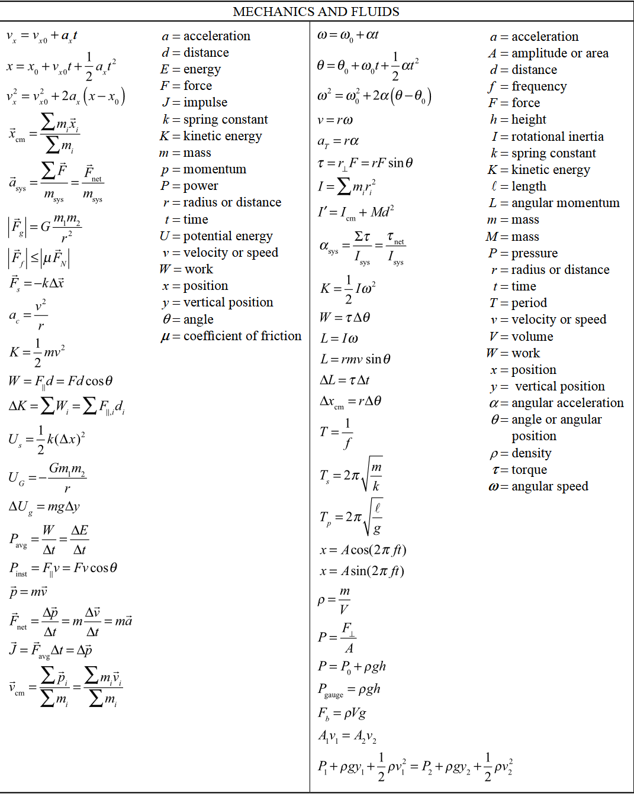
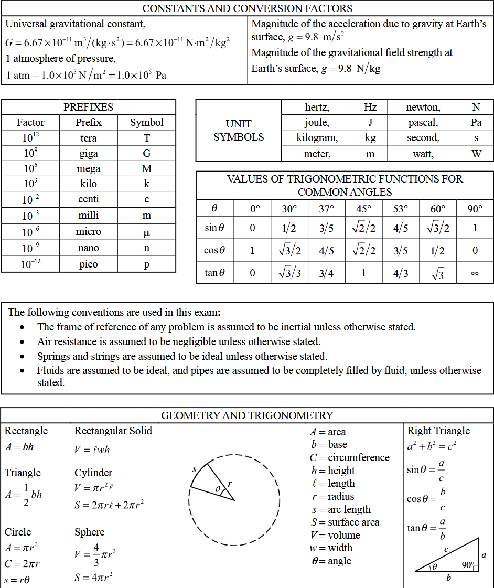

# algebraic-physics

A Python utility library for geometry and physics calculations based on the AP Physics 1 curriculum.

This library provides automated functions to solve for unknown variables using standard introductory mechanics equations. It accepts numerical inputs for known physical quantities to compute values across kinematics, dynamics, energy, momentum, and rotational motion.

## File Directory

```text
mathformulas/
│
├── .github/
│   └── workflows/
│       └── codeql.yml
│
├── assets/
│   ├── formulas.png
│   └── geometry.png
│
├── src/
│   ├── geometry/
│   │   ├── __init__.py
│   │   └── geom.py
│   │
│   └── physics/
│       ├── __init__.py
│       └── mechanics.py
│
├── tests/
│   └── make_cube.py
│
├── .gitignore
├── LICENSE
├── pyproject.toml
├── README.md
└── requirements.txt
```

## Tests Example

The file 'make_cube.py' under tests/ utilizes a dictionary for holding shapes. The square uses 0.0 floats, and relies on mechanics.py functions for calculations.

```python
#make_cube.py
import geometry.geom as gm
import physics.mechanics as pm

my_cube = {
    "side": 4,    # Side length, note that this can be subbed out for the result of a distance formula between two coordinates
    "mass": 10,   # Dummy mass
    "volume": 0, 

    "pos_x": 0.0, # Starts at coordinates (0,0)
    "pos_y": 0.0,

    "velocity_x": 0.0,
    "velocity_y": 0.0,
}
...

# Volume Calculation:
my_cube["volume"] = gm.cube_volume(my_cube["side"])
print(f'The volume is {my_cube["volume"]}')

...

# Physics Simulation:
dt = 0.1                            # Timestep
time = 0.0                          # Time that increases according to timestep
max_time = 5.0                      # Dummy max_time, in a real simulation this would be undeclared until input
current_acceleration = 1.0          # Dummy current_acceleration 
speedy_boost = pm.speed_booster(1)  # Connects to a speed boost function in 'mechanics.py'

while time < max_time:  
    current_acceleration = pm.speed_booster(current_acceleration)

    my_cube["velocity_x"] = pm.find_instantaneous_velocity(
        my_cube["velocity_x"],
        speedy_boost,
        dt
    )
    time += dt
```

## Source Formulas




